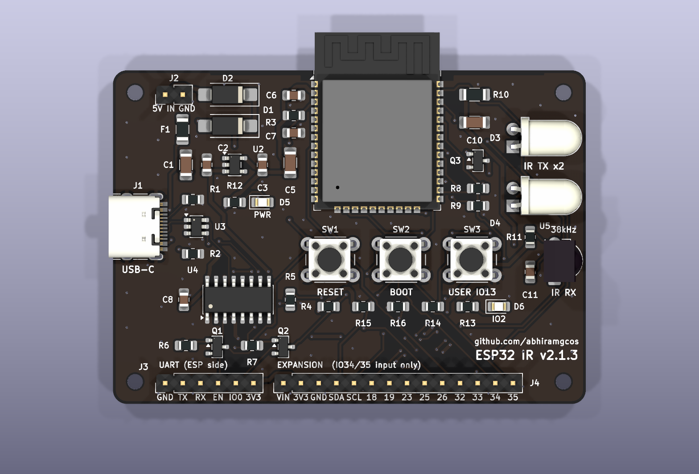
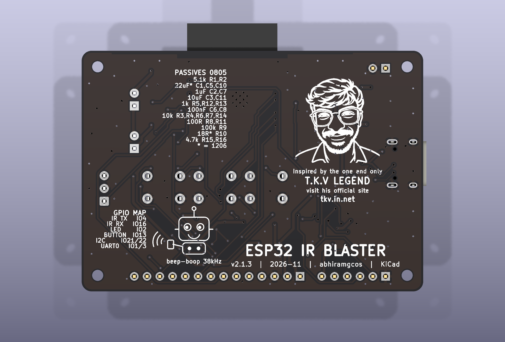
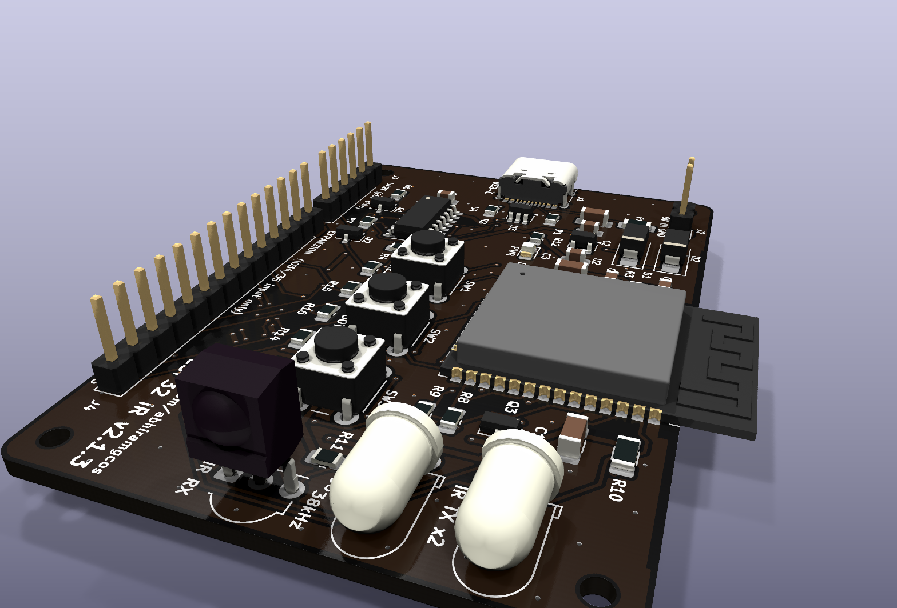
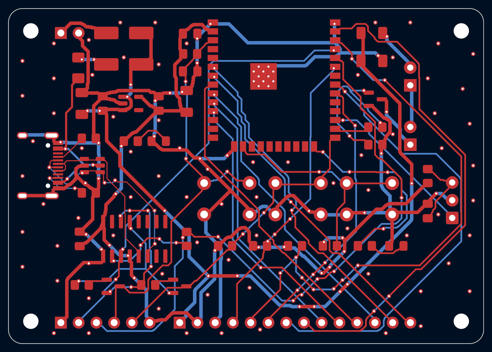
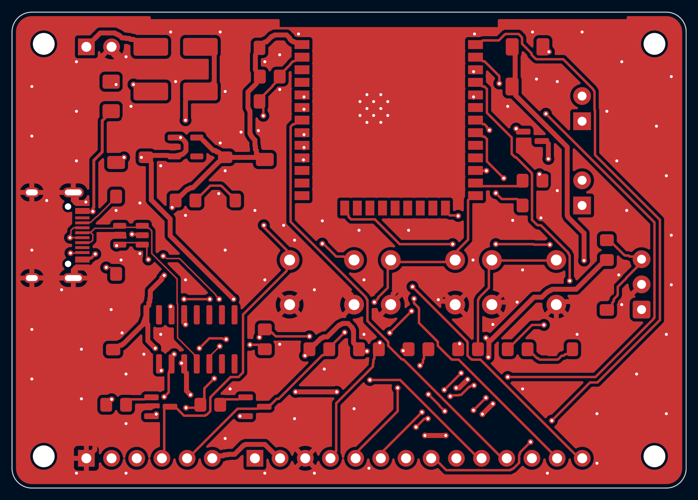
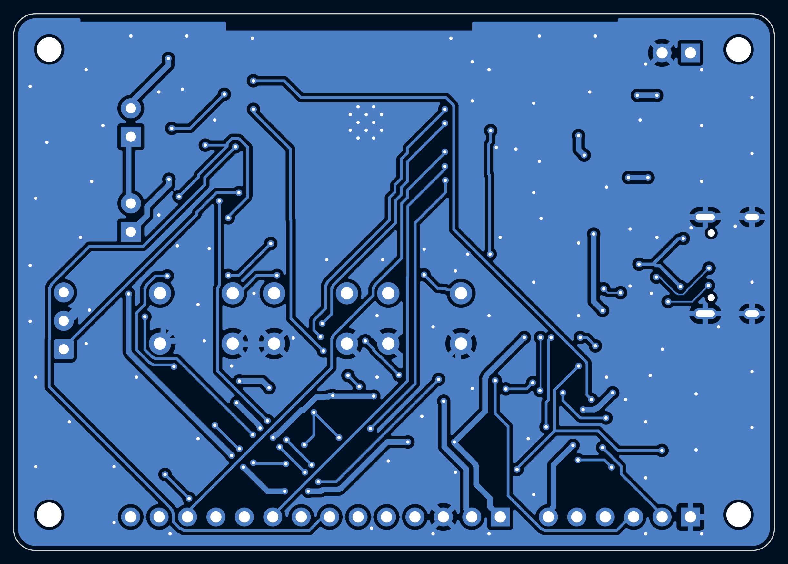
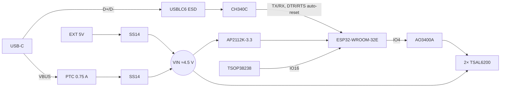

# ESP32 IR Blaster

**A Wi-Fi infrared remote you build yourself.** It learns the buttons of your existing remotes (TV, A/C, set-top
box, fan, LED strip) and plays them back from your phone, a script or Home Assistant.

[](https://github.com/abhiramgcos/Esp_ir_board/releases/latest)


[](LICENSE)


<sub>KiCad 3D render of the v2.1.3 board, not a photo. The USB-C model is a stand-in for the HRO part.</sub>

## Features

* **Strong IR output:** two 940 nm LEDs driven at ~100 mA through a MOSFET, ≈8–10 m line-of-sight range.
* **On-board receiver:** a 38 kHz TSOP38238 for learning codes. The receiver and both IR LEDs face out of
  the same board edge, so one side of the board points at your devices.
* **One-click flashing:** USB-C with a CH340C USB-serial chip and auto-reset; no buttons, no adapter.
* **Ready-to-use firmware:**
  * web UI, REST API, captive-portal Wi-Fi setup, OTA updates;
  * stores decoded, A/C and raw codes.
* **Home Assistant via ESPHome:** native buttons, a climate entity for A/C, and send-code actions, from a
  prebuilt image you adopt in one click.
* **Robust power:** USB ESD protection, resettable fuse, diode-OR'd external 5 V input, 600 mA LDO.
* **Expansion:** I²C with pull-ups plus 8 free GPIOs on a 14-pin header, and a separate UART header.
* **Hand-solder friendly:** 0805/1206 passives, SOT-23/SOIC parts, and a value table printed on the back.
  Can also be ordered assembled.

## Hardware at a glance

| | |
|---|---|
| MCU | ESP32-WROOM-32E (4 MB flash, Wi-Fi + BT), PCB antenna overhanging the board edge |
| Power | USB-C 5 V or EXT 5 V header → SS14 diode-OR → AP2112K-3.3 (600 mA) |
| IR transmit | 2× Vishay TSAL6200 in series, lying flat and pointing out of the right edge; 18 Ω, AO3400A low-side switch on IO4 |
| IR receive | Vishay TSOP38238 (38 kHz) on IO16; dome faces the same edge as the LEDs |
| USB-serial | CH340C, DTR/RTS auto-reset (2× MMBT3904) |
| User I/O | RESET, BOOT and USER (IO13) buttons; green power LED; blue LED on IO2 |
| Headers | J3 UART (6-pin), J4 expansion (14-pin), J2 EXT 5V |
| PCB | 68 × 48 mm, 2 layers, 1.6 mm, 4× M2 holes, JLCPCB/PCBWay standard process |

| Top | Bottom |
|---|---|
|  |  |

<sub>The back carries a silkscreen portrait tribute: *"Inspired by the one and only T.K.V legend"*. Visit his
site, [tkv.in.net](https://tkv.in.net).</sub>



<sub>The IR edge: the TSOP38238 receiver and both TSAL6200 LEDs (lying flat, leads bent 90°) face out of the
same side of the board.</sub>

### Copper layout

Two-layer board: signals on both sides, solid GND pour on both layers with via stitching, and a copper-free
strip under the ESP32 antenna. Colours follow KiCad: **red = top copper (F.Cu)**, **blue = bottom copper
(B.Cu)**, white = drills and vias.



<sub>Both copper layers overlaid with the ground pours hidden, so every trace and via is visible. Power nets
(VIN, 3V3, IR LED loop) use 0.5 mm tracks; signals use 0.25 mm; USB D+/D− and CC use 0.15 mm at the
connector.</sub>

| Top copper (F.Cu) | Bottom copper (B.Cu, viewed from below) |
|---|---|
|  |  |

Regenerate with `make copper`.

## Getting started

| Step | What to do | Guide |
|---|---|---|
| 1. Get a board | Upload `fab/esp_ir_board_v2_gerbers.zip` to JLCPCB or PCBWay (≈5 boards for a few dollars), optionally with SMD assembly | [esphome/README.md](esphome/README.md) | Home Assistant via ESPHome: adopt the prebuilt image or build your own config, learning codes, A/C climate |
| [docs/ORDERING.md](docs/ORDERING.md) |
| 2. Get the parts | BOM, what each part does, safe substitutes | [docs/COMPONENTS.md](docs/COMPONENTS.md) |
| 3. Assemble | Solder order and first power-up checks | [docs/COMPONENTS.md §3](docs/COMPONENTS.md#3-what-to-buy-for-hand-assembly) |
| 4. Flash | **Stand-alone firmware**: browser flasher (no install), Arduino IDE, or PlatformIO | [firmware/README.md](firmware/README.md) |
| 4b. …or Home Assistant | **ESPHome**: flash the prebuilt image, adopt it in HA, add your buttons | [esphome/README.md](esphome/README.md) |
| 5. Use | Join `ESP32-IR-Setup`, pick your Wi-Fi, open `http://irblaster.local` | [firmware/README.md#using-it](firmware/README.md#using-it) |
| Something wrong? | Power, USB, flashing, Wi-Fi and IR checks, step by step | [docs/TROUBLESHOOTING.md](docs/TROUBLESHOOTING.md) |

**Quickest flash:** download `esp32_ir_blaster_v2.1.1_full.bin` from
[Releases](https://github.com/abhiramgcos/Esp_ir_board/releases/latest). Open the
[ESP Tool web flasher](https://espressif.github.io/esptool-js/) in Chrome, connect to the CH340 port, and
program the file at address `0x0`.

## Pinout

| Function | GPIO | Notes |
|---|---|---|
| IR transmit | **IO4** | HIGH = LEDs on; the 38 kHz carrier is generated in software |
| IR receive | **IO16** | TSOP output, active low |
| Status LED (blue) | **IO2** | Strapping pin; the LED holds it low at boot, as required |
| USER button | **IO13** | Active low, 10 k pull-up |
| I²C | **IO21** SDA / **IO22** SCL | 4.7 k pull-ups on board |
| UART0 | IO1 TX / IO3 RX | Also on J3; an external adapter overrides the CH340 through 1 k |
| J4 expansion | VIN, 3V3, GND, SDA, SCL, IO18, 19, 23, 25, 26, 32, 33, 34, 35 | IO34/35 are input-only |

## Design notes



* **IR drive.** The LEDs run from VIN, not from the 3.3 V rail: (4.5 V − 2 × 1.35 V) / 18 Ω ≈ 100 mA during
  carrier pulses. That's inside the TSAL6200 pulsed rating, and it keeps IR bursts from disturbing the
  ESP32 supply. C10 (22 µF) is the local reservoir.
* **3.3 V rail.** The AP2112K has 0.25 V dropout and 600 mA output, which leaves margin over ESP32 Wi-Fi peaks
  (~400–500 mA) even from the diode-dropped 4.5 V VIN.
* **Auto-reset.** This is the standard two-transistor DTR/RTS circuit, so esptool, the Arduino IDE and
  PlatformIO can enter the bootloader on their own. A 1 k resistor in the CH340 TX line lets an adapter on J3
  take over UART0.
* **Antenna.** The module's antenna overhangs the top edge by ≈5.5 mm, with no copper, tracks or vias under it
  on either layer. Leave the space free in an enclosure.

Full schematic: [PDF](hardware/docs/esp_ir_board_schematic.pdf) · [PNG](docs/img/v2.1_schematic.png).

## Development

### Repository layout

```
hardware/    KiCad 9 project (schematic, PCB, rules) + schematic/assembly PDFs
fab/         Gerbers + drills (zip), BOM, JLCPCB BOM/CPL       <- regenerated by `make fab`
firmware/    Stand-alone firmware: Arduino sketch + PlatformIO project
esphome/     ESPHome package, example config and factory image config for Home Assistant
gen/         Python generators: circuit.py is the single source of truth for parts and nets
tools/       Independent Gerber connectivity checker, offscreen 3D renderer
scripts/     esp.sh (behind `make`), silk preview
setup/       Toolchain installer (apt/pacman/dnf + Python venv)
docs/        Ordering, components, troubleshooting, build log, v1 review, images
v1/          Original v1 fab files (reference only)
```

### Toolchain

```bash
git clone https://github.com/abhiramgcos/Esp_ir_board.git && cd Esp_ir_board
./setup/install.sh            # KiCad 9, gerbv, librsvg, Python venv with pcbnew (asks for sudo once)
source .venv/bin/activate
make help                     # open | sch | pcb | 3d | copper | gerbers | render | check | bom | fab | rebuild
```

Details: [setup/README.md](setup/README.md), [scripts/README.md](scripts/README.md).

### Editing the design

There are two ways to make changes:

* **In KiCad.** Open `hardware/esp_ir_board.kicad_pro`, edit, then run `make fab && make check`.
* **From code.** Change `gen/circuit.py` (parts and nets) or `gen/placement.py` (positions). Then run
  `gen/build.sh`. It regenerates the schematic, places and routes the board with the built-in 2-layer router,
  pours copper, places silkscreen and runs DRC into `build/`, in about 5 minutes. Copy the result into
  `hardware/` once you're happy with it.

The routing comes from `gen/router.py`. It is DRC-clean and functional, but it is not hand-polished; touching
it up in KiCad is welcome.

### Verification

`make check` runs all of these. The table shows the current results.

| Check | Tool | Result (v2.1) |
|---|---|---|
| Netlist vs `circuit.py` | `gen/erc.py` | 162 pins, 41 nets, 0 problems |
| Electrical rules | `kicad-cli sch erc` | 0 errors |
| Design rules + schematic parity | `kicad-cli pcb drc` | 0 errors, 0 unconnected |
| Manufactured copper vs schematic | `tools/gerber_connectivity.py` on the Gerbers | 41 nets, 0 shorts, 0 opens, 162/162 pins |
| Firmware | `pio run` | builds without warnings |
| ESPHome configs | `esphome config` / `esphome compile` | valid, compiles |

The remaining DRC **warnings** are expected:
* silk clipped at the board edge, where the ESP32 and USB-C overhang on purpose;
* net-name prefix notes (`VIN` vs `/VIN`) from the generated schematic.

## Status

* v2.1.3 hardware and v2.1.1 firmware are complete and verified by the checks above. **No board has been
  manufactured yet**, so treat the first build as a prototype run.
* Every SMD part has a verified, in-stock LCSC number, so JLCPCB's BOM tool matches the whole BOM
  automatically. The through-hole parts (IR LEDs, TSOP, buttons, headers) are left for hand soldering.
* Always check part rotations in the fab's placement preview.

## Documentation

| Document | Contents |
|---|---|
| [firmware/README.md](firmware/README.md) | Flashing (web, Arduino IDE, PlatformIO), Wi-Fi setup, web UI, REST API, Home Assistant, OTA |
| [esphome/README.md](esphome/README.md) | Home Assistant via ESPHome: adopt the prebuilt image or build your own config, learning codes, A/C climate |
| [docs/ORDERING.md](docs/ORDERING.md) | JLCPCB and PCBWay, bare and assembled, step by step |
| [docs/COMPONENTS.md](docs/COMPONENTS.md) | BOM, the role of each part, drop-in alternatives, assembly order |
| [docs/TROUBLESHOOTING.md](docs/TROUBLESHOOTING.md) | Power, USB, flashing, boot, Wi-Fi and IR debugging |
| [docs/BUILD_LOG.md](docs/BUILD_LOG.md) | How the board was designed, step by step, with images |
| [CHANGELOG.md](CHANGELOG.md) | Version history (v1 → v2.0 → v2.1) |

## License

* **Hardware** (`hardware/`, `fab/`, `v1/`, docs and images): [CERN-OHL-P-2.0](LICENSES/CERN-OHL-P-2.0.txt).
* **Software** (`firmware/`, `esphome/`, `gen/`, `tools/`, `scripts/`, `setup/`): [MIT](LICENSES/MIT.txt).

You can build, modify and sell boards and derivatives, including commercially. Keep the copyright and license
notices, and point to this repository as the source. See [LICENSE](LICENSE) for details.
