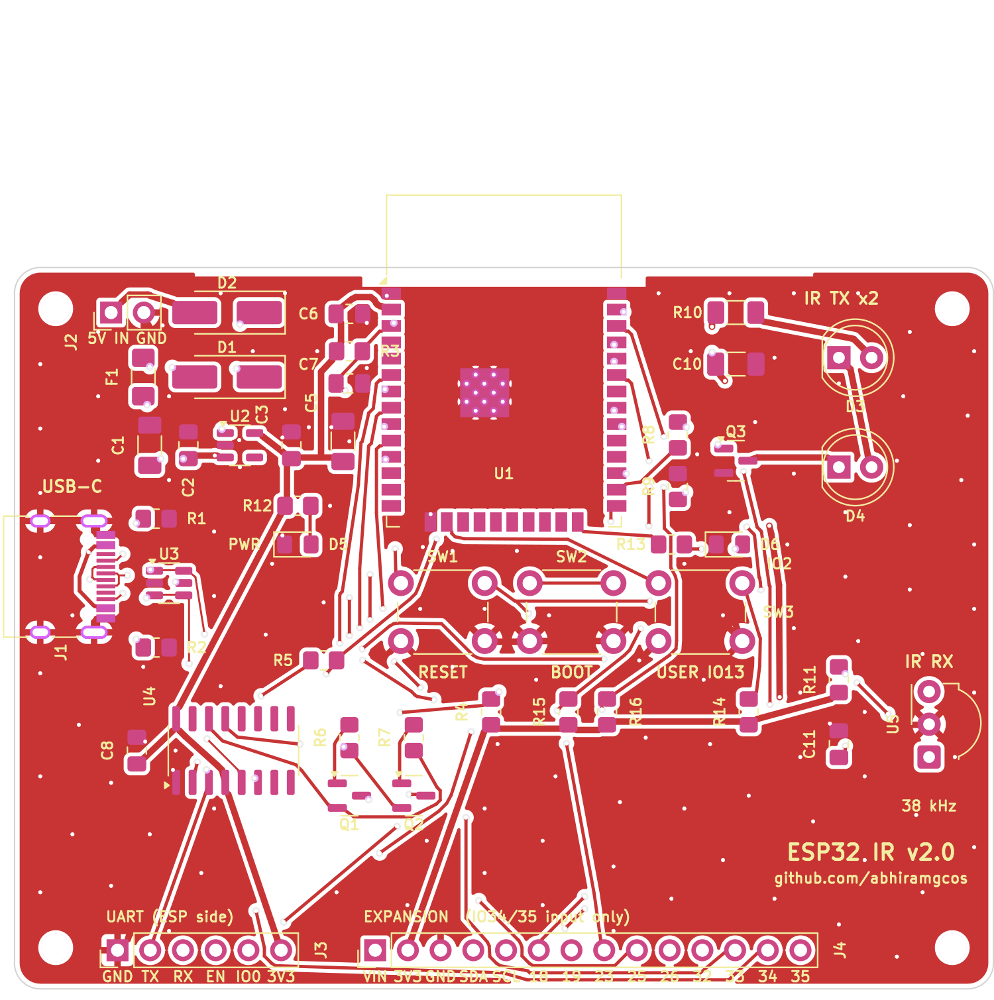
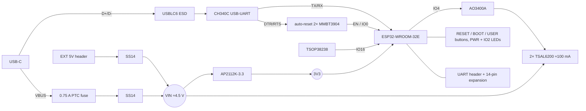

# ESP32 IR Blaster / Receiver: v2

ESP32 board that learns and sends infrared remote codes. It plugs into USB-C and flashes with one click,
drives two IR LEDs for room-wide range, and has a 38 kHz receiver, buttons, LEDs and a 14-pin expansion header.
The board is designed for **hand soldering first**, and can also be ordered **assembled from JLCPCB**
(BOM and pick-and-place files included).

| Top | Back (as you hold it) |
|---|---|
|  |  |

> New here? Read [docs/BUILD_LOG.md](docs/BUILD_LOG.md). It walks through every build step with screenshots,
> and each step is a separate commit.

## Block diagram



Full schematic: [hardware/docs/esp_ir_board_schematic.pdf](hardware/docs/esp_ir_board_schematic.pdf)

## What changed from v1

v1 was reviewed from its fab files ([docs/v1-review.md](docs/v1-review.md)). Every issue is fixed:

| v1 problem | v2 |
|---|---|
| LD1117 needs ~1.2 V headroom; it browns out after the input diode | **AP2112K-3.3** (0.25 V dropout) |
| 100 nF on the regulator input only | 22 µF + 1 µF on VIN, 10 µF + 22 µF + 100 nF on 3V3 |
| IR LED ≈20 mA from 3.3 V (short range) | **2 LEDs in series from VIN at ≈100 mA**, MOSFET switched |
| IR receiver missing from the BOM | **TSOP38238 on board**, in the BOM |
| Needs an external USB-UART adapter | **CH340C + auto-reset**: flash straight from the Arduino IDE / PlatformIO |
| No protection | USB ESD diode, resettable fuse, reverse-safe diode-OR of USB and EXT 5V |
| Mounting holes in the BOM, one part on the bottom, 0.2 mm vias | Holes excluded, all parts on top, 0.3 mm vias |
| No part numbers, rev "rev?" | MPN + LCSC columns, rev 2.0 |
| No I²C pull-ups | 4.7 k on SDA/SCL |

## Pinout

| Function | GPIO | Notes |
|---|---|---|
| IR transmit | **IO4** | High = LEDs on. Use RMT/IRremote at 38 kHz |
| IR receive | **IO16** | Active-low TSOP output |
| User LED (blue) | **IO2** | Strapping pin; the LED keeps it low at boot, which is correct |
| User button | **IO13** | Active-low, 10 k pull-up |
| I²C | **IO21 SDA / IO22 SCL** | 4.7 k pull-ups on board |
| UART0 | IO1 TX / IO3 RX | Also on J3 for an external adapter (it overrides the CH340 through 1 k) |
| Expansion J4 | VIN, 3V3, GND, SDA, SCL, IO18, 19, 23, 25, 26, 32, 33, 34, 35 | IO34/35 are input-only |

Arduino quick start:

```cpp
#include <IRremote.hpp>
void setup() {
  IrReceiver.begin(16);      // TSOP38238
  IrSender.begin(4);         // 2x TSAL6200 via AO3400A
  pinMode(2, OUTPUT);        // blue LED
  pinMode(13, INPUT_PULLUP); // USER button
}
```

## Power budget

* **USB:** 5 V → fuse → SS14 (≈0.4 V) → VIN ≈4.5 V.
* **3V3 rail:** the AP2112K gives 600 mA, comfortably above the ESP32's Wi-Fi peaks (~400–500 mA).
* **IR LEDs:** they run from VIN, not the 3.3 V regulator: (4.5 − 2 × 1.35 V) / 18 Ω ≈ 100 mA while the 38 kHz
  carrier is on. That's within the TSAL6200 rating for pulsed use.
* **EXT 5V and USB together:** you can connect both. The diode-OR feeds the board from whichever is higher.

## Hand-soldering guide

Every SMD footprint uses KiCad's "HandSolder" pads: 0805/1206 passives, SOIC-16, SOT-23 and SMA. The back
silkscreen has a **value table**, so you don't need a laptop at the bench.

1. **USB-C (J1).** Do this first, while the area is open. Tin the pads, add flux, then drag-solder.
   Check A6/A7/B6/B7 for bridges with a magnifier.
2. **U3 ESD, U4 CH340C, U2 LDO, Q1–Q3.**
3. **0805 passives and LEDs.** Green D5 is power and blue D6 is IO2; the cathode mark goes toward the line on
   the silkscreen.
4. **1206 parts (C1, C5, C10, R10, F1) and the SS14 diodes (D1, D2).** The diode band goes to the "K" side.
5. **Smoke test.** Plug in USB. You should see 3.3 V across C3 and the PWR LED lit. The PC should show a
   CH340 serial port.
6. **ESP32 module (U1).** Tack two corners and solder the castellations. Then heat the thermal pad from the
   back through the via field and feed in a little solder.
7. **Through-hole parts:**
   * Headers, then the buttons.
   * **IR LEDs:** the short leg / flat side goes in the **square pad**. Bend them 90° to face out of the right edge.
   * **TSOP38238:** pin 1 (OUT) goes in the square pad, dome facing outward.

## Ordering

| File | Use |
|---|---|
| `fab/esp_ir_board_v2_gerbers.zip` | Upload to JLCPCB / PCBWay: 2 layers, 1.6 mm, HASL or ENIG, any colour |
| `fab/BOM_JLCPCB.csv` + `fab/CPL_JLCPCB.csv` | JLC SMT assembly (SMD parts only; through-hole parts are hand-soldered) |
| `fab/BOM_full.csv` | Everything, with MPNs, for LCSC / Mouser / local shops |
| `hardware/docs/assembly_top.pdf` | Printable placement drawing |

Before you order:

* **LCSC numbers** are filled in only for common parts. Check stock, and add part numbers for the ESP32,
  TSOP, TSAL6200, PTC fuse and LEDs, before using JLC assembly.
* **Rotations:** JLC rotations sometimes need a 90/180° fix. Check their placement preview.
* **ESP32 antenna:** it overhangs the top edge by ≈5.5 mm on purpose, which is best for Wi-Fi. Leave room in
  the enclosure.

## Verification

| Check | Result |
|---|---|
| Schematic netlist vs design (`gen/erc.py`) | 162 pins, 41 nets, 0 problems |
| KiCad DRC (`gen/drc.py`) | 0 clearance / unconnected / hole / dangling errors (silk-near-edge warnings only) |
| Independent Gerber copper check (`tools/gerber_connectivity.py`) | 41 nets, 0 shorts, 0 opens, 162/162 pins on the right net |

## Repository layout

```
hardware/     KiCad project (.kicad_pro/.kicad_sch/.kicad_pcb/.kicad_dru) + PDFs
fab/          Gerbers, drills, BOMs, CPL, zip
gen/          Python generators: circuit.py (single source of truth), placement, router, silkscreen, BOM
tools/        Gerber connectivity checker used on v1 and v2
docs/         Build log, v1 review, images
v1/fab/       Original v1 fab package, for reference
```

**Edit and rebuild.** You can open `hardware/esp_ir_board.kicad_pro` in KiCad 7 or newer (including 10) and
edit it there. Or change `gen/circuit.py` / `gen/placement.py` and run `gen/build.sh`.

**About the routing.** It was produced by the small maze router in `gen/router.py`. It passes DRC, but it is
not hand-polished: some traces run at odd angles. Feel free to tidy it in KiCad. The rules stay in the project.
