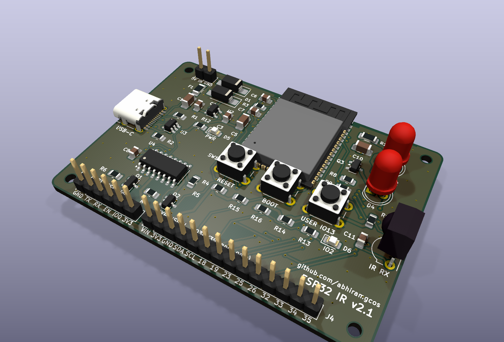
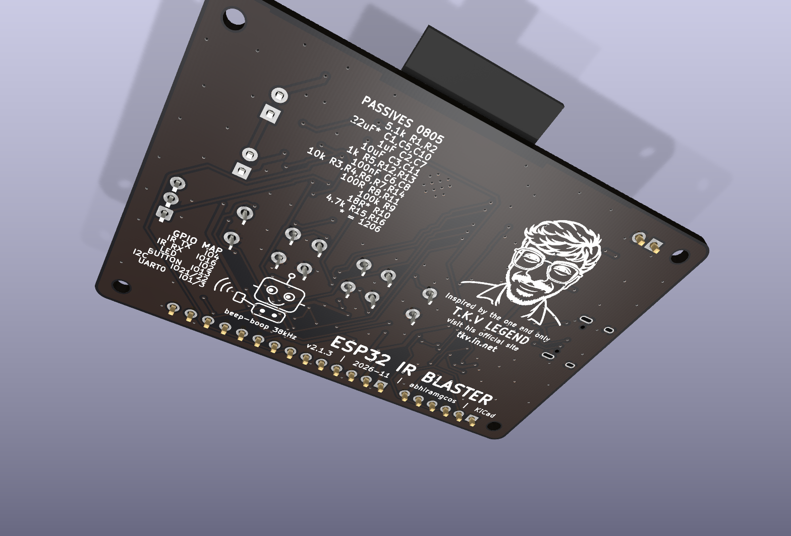
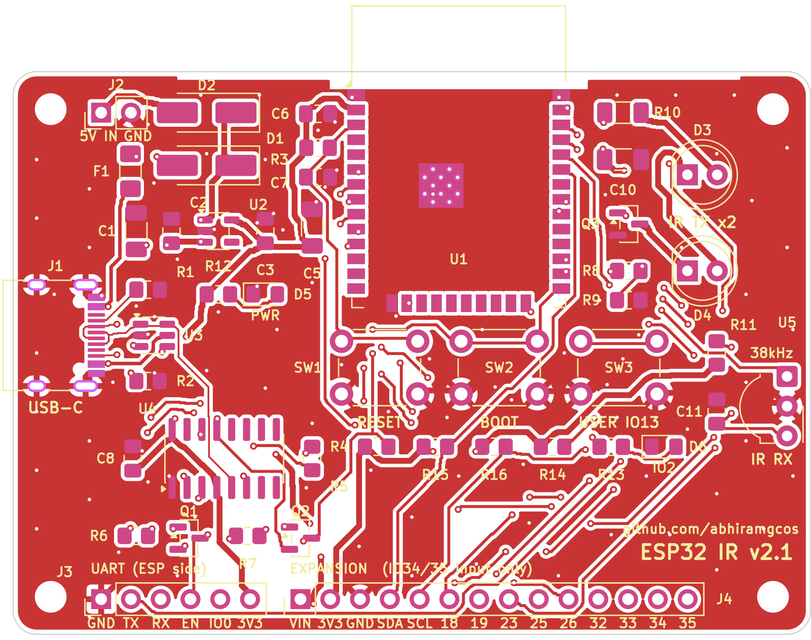
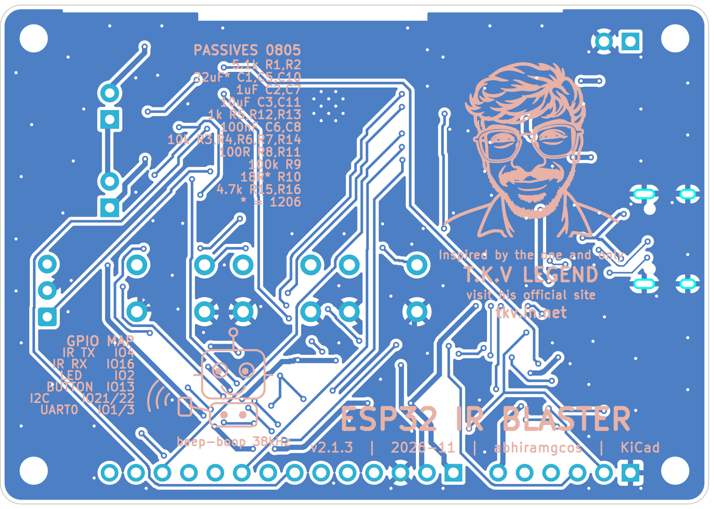
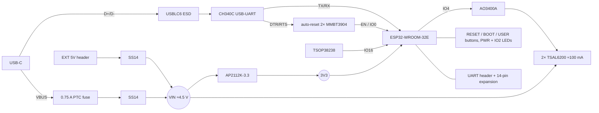

# ESP32 IR Blaster / Receiver: v2.1

An ESP32 board that **learns and sends infrared remote codes** over Wi-Fi. It plugs into USB-C and flashes with
one click. Two IR LEDs give it room-wide range, and it has a 38 kHz receiver, buttons, LEDs and a 14-pin
expansion header.

* Designed for **hand soldering first**, and can also be ordered **assembled from JLCPCB or PCBWay**.
* Ships with **complete firmware**: web UI, REST API, learn/save/send, OTA updates.



> **These are 3D renders, not photos.** No v2.1 hardware has been built yet. They come from the real KiCad
> board file with `kicad-cli pcb render`, using KiCad's official 3D models. Two models are stand-ins:
> * The USB-C connector uses the GCT USB4105 model; the HRO part has no stock model but the same shape.
> * The 5 mm IR LEDs show as red generic LEDs; the real TSAL6200 is clear/blue.

| Top | Bottom |
|---|---|
|  |  |
| **Top silkscreen + copper** | **Back (as you hold it)**: title, GPIO map, passives table, robot |
|  |  |

## Guides

| I want to… | Read |
|---|---|
| **Order the PCB** (bare or assembled) from JLCPCB / PCBWay | [docs/ORDERING.md](docs/ORDERING.md) |
| Know **every component**, what it does, and **which substitutes are safe** | [docs/COMPONENTS.md](docs/COMPONENTS.md) |
| **Flash the firmware** and use the board (web UI, API, button, Home Assistant) | [firmware/README.md](firmware/README.md) |
| See how the board was built, step by step with screenshots | [docs/BUILD_LOG.md](docs/BUILD_LOG.md) |
| Set up the KiCad / Python toolchain on Linux | [setup/README.md](setup/README.md) |

## Quick start

**Build and verify the hardware files:**

```bash
mkdir -p ~/Desktop/projects && cd ~/Desktop/projects
git clone https://github.com/abhiramgcos/Esp_ir_board.git && cd Esp_ir_board
./setup/install.sh          # KiCad, gerbv, rsvg + .venv (asks for sudo); add --conda for a conda env too
source .venv/bin/activate
make check                  # ERC + DRC + independent Gerber connectivity check
make help                   # open | sch | pcb | 3d | render3d | gerbers | render | check | bom | fab | rebuild
```

**Flash the firmware** (board plugged in over USB-C):

```bash
pip install platformio
cd firmware && pio run -t upload && pio device monitor
```

Then join the Wi-Fi network **ESP32-IR-Setup**, pick your network, and open **http://irblaster.local**.

## v2.0 → v2.1: optimised layout

| | v2.0 | **v2.1** |
|---|---|---|
| Board size | 76 × 56 mm (4256 mm²) | **68 × 48 mm (3264 mm²), −23 %** |
| Track length | 1733 mm | **1624 mm (−6 %)** |
| Vias (signal + GND stitching) | 220 | **201** |
| Routing | 90° maze routing | **45° (octilinear) routing**, power nets first, rip-up and retry |
| ESP32 antenna | board-edge overhang | overhang **plus a copper/track/via keep-out strip** on both layers |
| USB-C | normal clearances | dedicated fine-pitch rules: 0.15 mm D+/D−/CC tracks, VBUS exits its pad straight |
| Silkscreen | positions hard-coded | placed automatically from the outline and footprints; no silk on pads, no overlaps |
| 3D models | box fallbacks | real ESP32-WROOM-32E model, USB-C stand-in, official KiCad renders |
| Toolchain | KiCad 7 | **KiCad 9** (generators still run on 7) |
| Firmware | snippet only | **full firmware** in [`firmware/`](firmware) |

The circuit is unchanged from v2.0: same parts, same nets, same pin map.

## Block diagram



* Full schematic: [hardware/docs/esp_ir_board_schematic.pdf](hardware/docs/esp_ir_board_schematic.pdf)
* PNG version: [docs/img/v2.1_schematic.png](docs/img/v2.1_schematic.png)

## Pinout

| Function | GPIO | Notes |
|---|---|---|
| IR transmit | **IO4** | High = LEDs on, 38 kHz carrier generated in software (IRremoteESP8266) |
| IR receive | **IO16** | Active-low TSOP output |
| User LED (blue) | **IO2** | Strapping pin; the LED keeps it low at boot, which is correct |
| User button | **IO13** | Active-low, 10 k pull-up |
| I²C | **IO21 SDA / IO22 SCL** | 4.7 k pull-ups on board |
| UART0 | IO1 TX / IO3 RX | Also on J3 for an external adapter (it overrides the CH340 through 1 k) |
| Expansion J4 | VIN, 3V3, GND, SDA, SCL, IO18, 19, 23, 25, 26, 32, 33, 34, 35 | IO34/35 are input-only |

## Firmware in one paragraph

[`firmware/`](firmware) is a PlatformIO project. It uses IRremoteESP8266 2.8.6, ArduinoJson 7 and WiFiManager.

* **Learn:** decodes NEC, Sony, RC5/6, Samsung, LG, Panasonic and many A/C protocols; anything else is stored
  as raw timings.
* **Store:** saves named codes in flash and replays them through the IR LEDs.
* **Control:** a mobile-friendly web page, a JSON REST API, the serial console, and the USER button:
  * tap = send,
  * hold 1 s = learn,
  * hold 5 s = reset Wi-Fi.
* **Update:** over the air after the first USB flash.

It compiles to 1.08 MB of flash (55 % of the OTA slot) and 50 kB of static RAM. See
[firmware/README.md](firmware/README.md).

## Power budget

* **USB:** 5 V → fuse → SS14 (≈0.4 V) → VIN ≈4.5 V.
* **3V3 rail:** the AP2112K gives 600 mA, comfortably above the ESP32's Wi-Fi peaks (~400–500 mA).
* **IR LEDs:** they run from VIN, not the 3.3 V regulator: (4.5 − 2 × 1.35 V) / 18 Ω ≈ 100 mA while the 38 kHz
  carrier is on. That's within the TSAL6200 rating for pulsed use.
* **EXT 5V and USB together:** you can connect both. The diode-OR feeds the board from whichever is higher.

## Hand-soldering guide (short version)

Every SMD footprint uses KiCad's "HandSolder" pads, and the back silkscreen has a **value table**. The full
part list, substitutes and power-up checks are in [docs/COMPONENTS.md](docs/COMPONENTS.md).

1. **USB-C (J1).** Tin, flux, drag-solder. Check A6/A7/B6/B7 for bridges.
2. **U3 ESD, U4 CH340C, U2 LDO, Q1–Q3**, then the 0805/1206 passives, LEDs, SS14 diodes and fuse.
3. **Smoke test.** Plug in USB. You should see 3.3 V on C3, the PWR LED lit, and a CH340 serial port on the PC.
4. **ESP32 module (U1).** Tack two corners, solder the castellations, then heat the thermal pad from the back
   through the via field.
5. **Through-hole parts:**
   * Headers, then the buttons.
   * **IR LEDs:** the flat side / short leg goes in the **square pad**.
   * **TSOP38238:** OUT goes in the square pad, dome facing outward.

## Verification (v2.1, KiCad 9.0.8)

| Check | Result |
|---|---|
| Schematic netlist vs design (`gen/erc.py`) | 162 pins, 41 nets, 0 problems |
| KiCad ERC (`kicad-cli sch erc`) | 0 errors |
| KiCad DRC (`kicad-cli pcb drc --schematic-parity`) | **0 errors, 0 unconnected**. Warnings only: silk clipped at the edge where the ESP32 and USB-C overhang on purpose, and net-name prefix notes (`VIN` vs `/VIN`). |
| Independent Gerber copper check (`tools/gerber_connectivity.py`) | 41 nets, 0 shorts, 0 opens, 162/162 pins on the right net |
| Firmware build (`pio run`) | success, no warnings in project code |

Run them all with `make check`.

**Not verified:** the board has not been manufactured or powered yet, and the firmware has not run on real
hardware. The first build is the real test.

## Before you order

* **LCSC numbers** are filled in only for common parts. Pick the ESP32, TSOP, TSAL6200, PTC fuse and LEDs in
  JLC's BOM tool ([docs/ORDERING.md](docs/ORDERING.md) §A2).
* **Rotations:** check JLC's placement preview for every IC, diode and LED.
* **ESP32 antenna:** it overhangs the top edge by ≈5.5 mm on purpose, which is best for Wi-Fi. Leave room in
  the enclosure.

## Repository layout

```
hardware/     KiCad project (.kicad_pro/.kicad_sch/.kicad_pcb/.kicad_dru) + PDFs  <- v2.1
fab/          Gerbers, drills, BOMs, CPL, zip (make fab)
firmware/     PlatformIO firmware: learn / store / send IR, web UI, REST API, OTA
gen/          Python generators: circuit.py (single source of truth), placement, router, silkscreen, BOM
tools/        Gerber connectivity checker, offscreen 3D renderer
scripts/      esp.sh (make targets), silk_preview.sh
docs/         Ordering, components, build log, v1 review, images
v1/fab/       Original v1 fab package, for reference
```

**Edit and rebuild.** Open `hardware/esp_ir_board.kicad_pro` in KiCad 7 or newer and edit it there. Or change
`gen/circuit.py` / `gen/placement.py` and run `gen/build.sh` (about 5 min; writes to `build/`, never
`hardware/`).

**About the routing.** It was produced by the small maze router in `gen/router.py`. It passes DRC, but it is
not hand-polished. Feel free to tidy it in KiCad; the rules stay in the project.

## History

* **v1:** original board, reviewed from its Gerbers ([docs/v1-review.md](docs/v1-review.md)).
* **v2.0:** full redesign fixing all 10 v1 issues: AP2112K LDO, 100 mA IR drive, on-board TSOP, CH340C +
  auto-reset, ESD/fuse/diode-OR, I²C pull-ups. Tag/branch `main` before v2.1.
* **v2.1:** this version. Same circuit, 23 % smaller, 45° routing, antenna keep-out, KiCad 9, 3D renders,
  firmware and guides.
