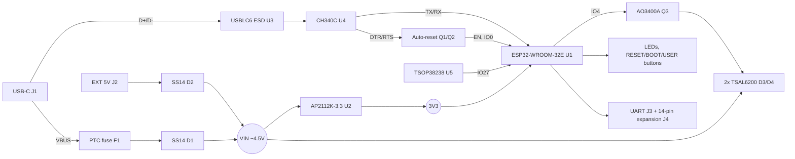
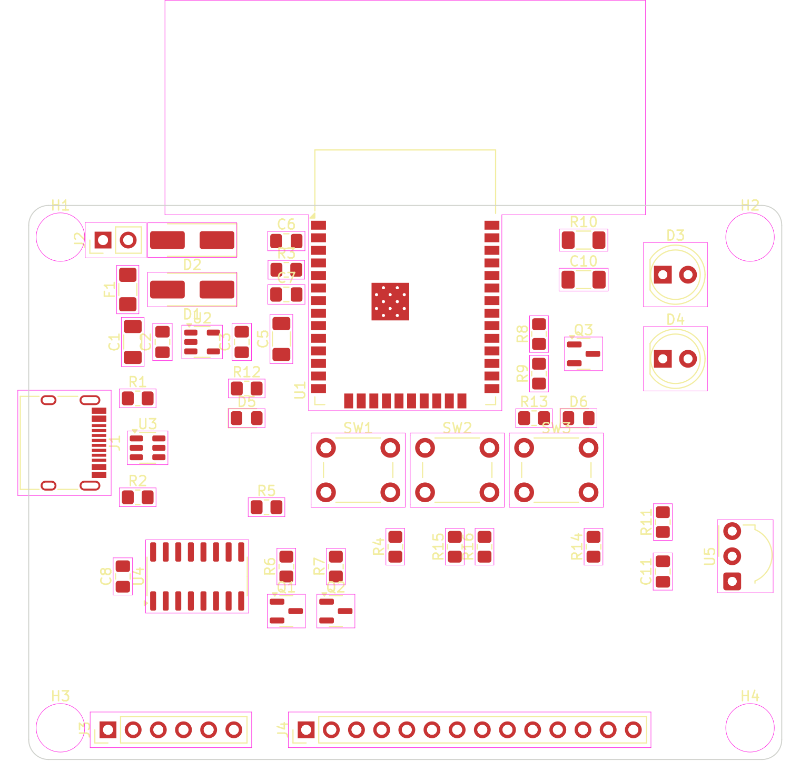
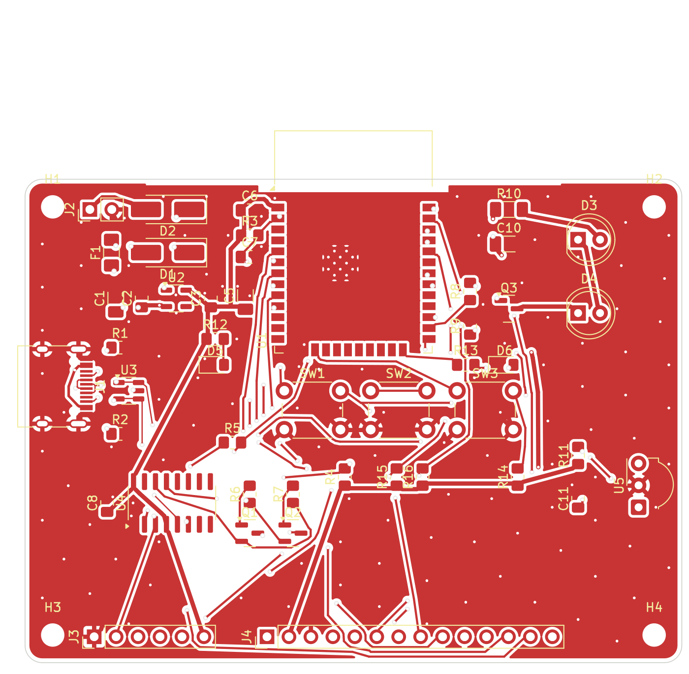
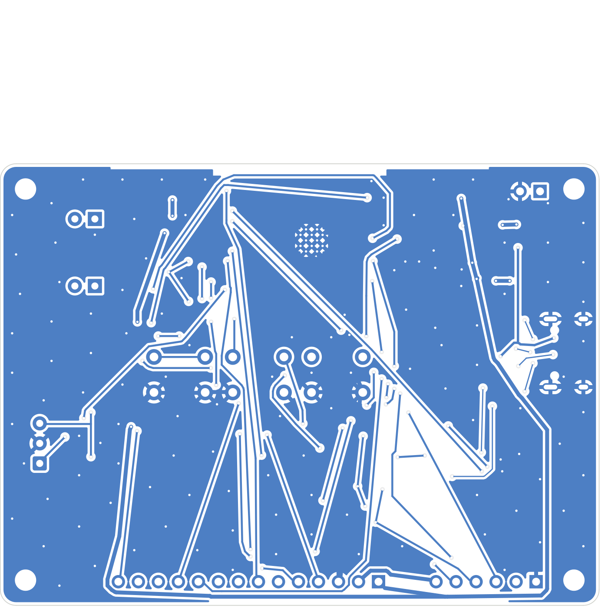
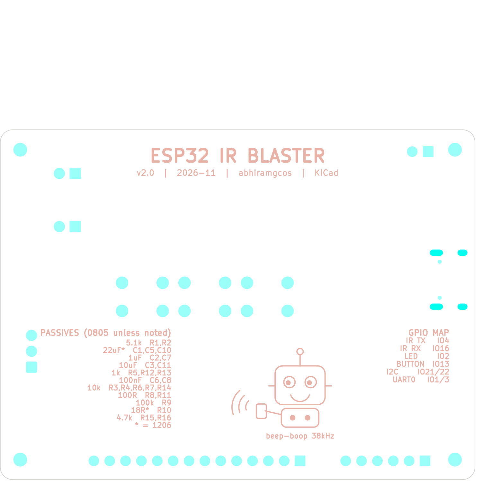
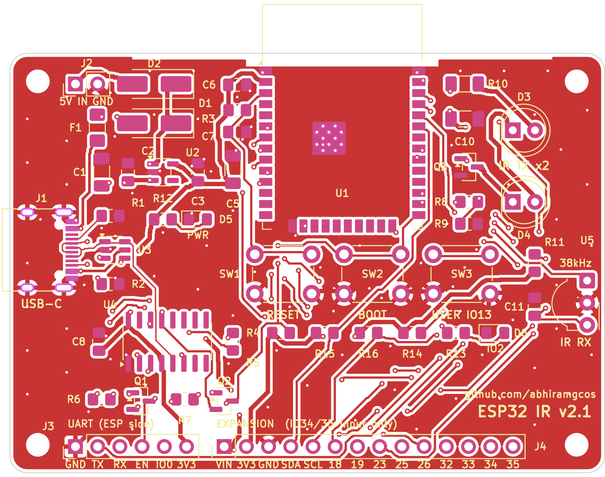
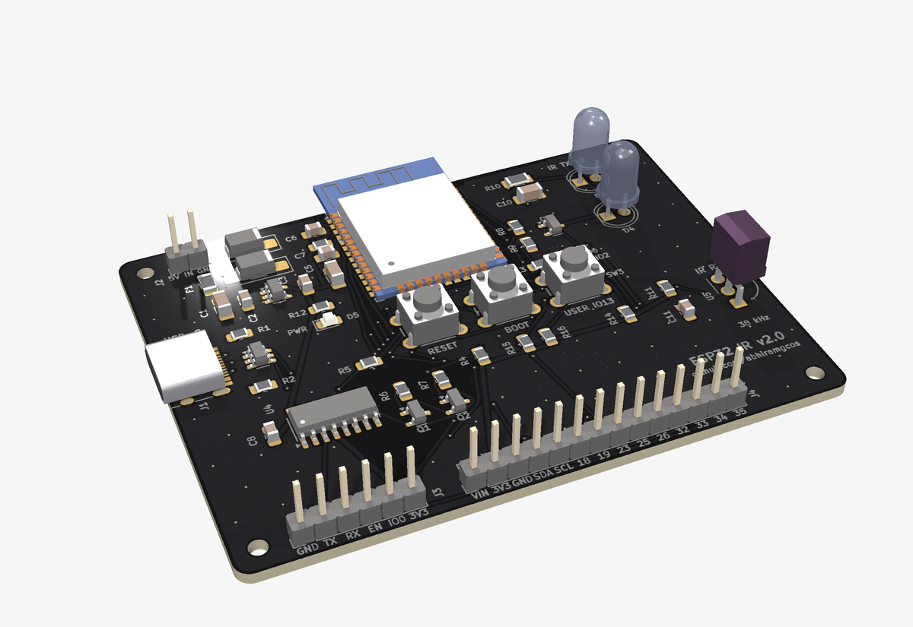
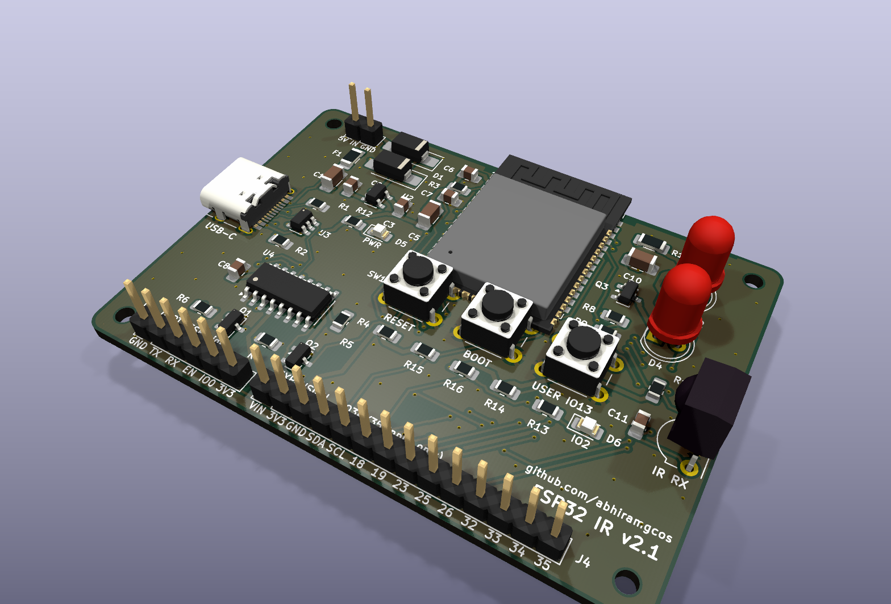

# Build log

One entry per build step, newest at the bottom. Each step is its own git commit, so you can check out any stage.

## Step 1: Archive v1 and review it

* The v1 fab outputs are kept in `v1/fab/` for reference.
* The review is in [v1-review.md](v1-review.md). The copper connectivity is clean, but there are ten design and fab issues.
* The Gerber analysis scripts are in `tools/`.

## Step 2: v2 schematic

The whole circuit is described in one Python file, `gen/circuit.py`. Running `gen/sch.py` turns it into
`hardware/esp_ir_board.kicad_sch`, which you can open in KiCad 7 or newer.




**Checks.** KiCad 7's command line has no ERC command, so `gen/erc.py` compares the exported netlist with
`circuit.py` instead.

* Result: 162 pin assignments checked, 41 nets, 0 problems (no mismatches, no single-pin nets).
* Unused pins carry no-connect flags. Passive-driven power nets have PWR_FLAGs.

**Key design decisions**

| Block | Choice | Reason |
|---|---|---|
| 3.3 V | AP2112K-3.3, 600 mA, ~250 mV dropout | Stays in regulation from a 4.3 V VIN (v1's LD1117 did not) |
| Programming | CH340C (no crystal) at 3.3 V + 2× MMBT3904 auto-reset | One-click flashing over USB-C |
| UART override | 1 k between CH340 TXD and ESP RX | An external adapter on J3 still works |
| IR TX | 2× TSAL6200 in series, 18 Ω from VIN, AO3400A low-side | ≈100 mA at 38 kHz for room-wide range |
| IR RX | TSOP38238 + 100 Ω/10 µF supply filter | Vishay-recommended supply filter |
| User I/O | Blue LED on IO2, USER button on IO13, I²C pull-ups 4.7 k | Ready for firmware and sensors |
| Protection | USBLC6-2SC6 ESD, 0.75 A PTC, Schottky diode-OR | Plugging in USB and external 5 V together is safe |

**GPIO map**

| Function | GPIO | | Function | GPIO |
|---|---|---|---|---|
| IR TX | IO4 | | I²C SDA / SCL | IO21 / IO22 |
| IR RX | IO27 | | Expansion | IO18, 19, 23, 25, 26, 32, 33, 34*, 35* |
| User LED | IO2 | | UART0 | IO1 (TX), IO3 (RX) |
| User button | IO13 | | Boot / reset | IO0 / EN |

\* IO34 and IO35 are input-only.

## Step 3: PCB placement, routing and ground pours

**Board:** 76 × 56 mm, 2 layers, 1.6 mm thick, four M2 holes at the corners.

**Placement** (`gen/placement.py`). The parts are grouped by function:

* ESP32 at the top centre, with the antenna hanging ≈5.5 mm past the board edge.
* Power and USB on the left.
* IR transmit and receive on the right edge, facing out.
* Buttons in a row under the module.
* Headers along the bottom edge.



**Routing** (`gen/router.py`). Freerouting couldn't be run in the build sandbox, so the board uses a
purpose-written 2-layer maze router:

* Each net is a cost grid at 0.05 mm with three planes: F.Cu, vias and B.Cu.
* scikit-image's minimum-cost-path solver connects each pad to the net's tree, nearest pad first.
* Failed nets are ripped up and retried first on the next pass.
* Paths are then straightened by string-pulling, and stubs are cleaned up.

Track widths:

| Nets | Width |
|---|---|
| VIN, +3V3, GND, IR LED | 0.5 mm |
| VBUS | 0.3 mm |
| Signals | 0.25 mm |
| USB D+/D− and CC (0.5 mm-pitch USB-C pins) | 0.15 mm |

Other routing rules:

* No top-layer tracks under the ESP32 body.
* No copper under the 1 mm of antenna that sits over the board.

**Pours.** There is a GND pour on both layers, with ≈110 stitching vias. Any via that lands on an isolated
island is removed automatically.

| Top (F.Cu + silk) | Bottom (B.Cu) |
|---|---|
|  |  |

**DRC** (KiCad 7 `pcbnew` engine, `gen/drc.py`)

* 0 clearance errors, 0 hole-clearance errors, 0 unconnected items, 0 dangling tracks or vias.
* What remains is silkscreen cosmetics (cleaned up in step 4). There is also a "library not in configuration"
  notice, which only means the build machine had no global footprint library table.
* `hardware/esp_ir_board.kicad_dru` allows one thermal spoke on GND pins hemmed in by tracks.

**Note:** the routing is automatic and functional, but not hand-polished. Open it in KiCad and tidy
traces if you want a neater look. The DRC rules travel with the project.

## Step 4: Silkscreen labels and doodle

`gen/silk.py` adds:

* **Pin labels** on every connector:
  * J3 UART: GND, TX, RX, EN, IO0, 3V3
  * J4 expansion: VIN, 3V3, GND, SDA, SCL, 18, 19, 23, 25, 26, 32, 33, 34, 35
  * J2: 5V IN, GND
* **Function labels:** RESET, BOOT, USER IO13, PWR and IO2 LEDs, IR TX ×2, IR RX 38 kHz, USB-C, board name.
* **Reference designators:** each one tries several spots and takes the one that clears pads, other labels
  and the board edge.
* **Back side:**
  * Big title and a revision line.
  * A **GPIO map** and a **passives value table** (which value goes on which R/C), so hand-soldering
    needs no laptop.
  * An original doodle: a robot beaming IR.
* **Text size:** all text is at least 0.8 mm high with 0.15 mm stroke, which budget fabs can print.

| Top | Back (as you hold it) |
|---|---|
|  |  |

DRC after this step: still 0 electrical errors. Four warnings remain for labels close to the board edge
(the J4 pin numbers); they are intentional and print fine.

## Step 5: Fab outputs, BOM and final verification

* **Gerbers and drills:** `fab/gerbers/` plus `fab/esp_ir_board_v2_gerbers.zip`, ready to upload.
* **BOMs:**
  * `fab/BOM_full.csv`: every part, with MPN and LCSC, and whether it's SMT or hand-soldered.
  * `fab/BOM_JLCPCB.csv` + `fab/CPL_JLCPCB.csv`: SMD parts only (through-hole parts are hand-soldered).
  * Mounting holes are excluded.
* **PDFs:** `hardware/docs/esp_ir_board_schematic.pdf` and `hardware/docs/assembly_top.pdf`.
* **Independent check:** the same Gerber tool used on v1 was run on the v2 Gerbers:

```
nets: 41  shorts: 0  opens: 0
schematic pins checked: 162  mismatches: 0
```

So the copper that gets manufactured matches the schematic, pin for pin.

## Step 6: v2.1 optimisation, KiCad 9, 3D renders, firmware and guides

Same circuit as v2.0; layout, tooling and documentation reworked. Built on Ubuntu 26.04 with KiCad 9.0.8.

### 6a. Toolchain on KiCad 9
* `pcb.py`: `FOOTPRINT.SetProperty` was removed in KiCad 8, so MPN/LCSC are now hidden `PCB_FIELD`s.
  Footprints also keep their library nickname (`SetFPID`), which removes 51 schematic-parity warnings.
* `drc.py` / `zones.py`: `EDA_UNITS_MILLIMETRES` → `EDA_UNITS_MM` (falls back to the old name on KiCad 7).
* `silk.py`:
  * KiCad 9 adds new drawings at the *front* of the list, so blocks are now tracked by UUID.
  * Removed items are kept referenced, because freeing them corrupted the board under SWIG (segfault on a
    second run). Re-runs are now idempotent.
* Installer: `pyrender` is installed with `--no-deps` so PyOpenGL 3.1.7 can stay pinned (pip refused the
  combination on Python 3.14).
* v2.0 passed `make check` on KiCad 9 before anything was changed.

### 6b. Compact layout and routing
* **Placement** (`gen/placement.py`): **68 × 48 mm**, down from 76 × 56 (−23 % area).
* **Router** (`gen/router.py`):
  * 45° string-pulling, power nets first, higher via cost, rip-up with order jitter.
  * The tight USB-C margin (`fine_zone`) now applies only to the 0.5 mm-pitch D+/D−/CC nets. VBUS keeps the
    normal margin, so it leaves its pad straight instead of cutting past the A1/B12 GND pad. That diagonal
    entry caused the last 4 clearance errors (0.177–0.190 mm).
  * Via sites now keep ≥0.25 mm hole-to-hole from **every** drilled hole, including same-net ones. This fixes
    a warning at J4 pin 1.
* **Antenna keep-out:** no tracks, vias or pour under the antenna strip on either layer.
* Router run: 16 rip-up rounds, about 5 min, all nets routed.

### 6c. Silkscreen for any board size
`silk.py` derives everything from `BOARD` and the footprints instead of fixed coordinates:
* Functional labels (USB-C, PWR, IO2, IR TX ×2, IR RX / 38 kHz) search around their part's courtyard.
* The front title and URL do a grid search for free space.
* The back blocks (title, GPIO map, passives table, robot doodle) each scan the back for the spot with no
  through-hole pads and the fewest vias.
* Three crowded reference designators (R3, C7, D6) and U5 use hand-picked offsets (`REF_AT`) checked by DRC.

Result: **no silk on pads and no silk overlaps**. Previews come from `scripts/silk_preview.sh`.

| Top | Back (as you hold it) |
|---|---|
|  |  |

### 6d. 3D renders
* KiCad's 3D library (`kicad-packages3d`) is now installed.
* U1 uses the real **ESP32-WROOM-32E** model.
* J1 uses the GCT USB4105 model as a stand-in for the HRO TYPE-C-31-M-12, which has no stock model but the
  same 16-pin top-mount shape.
* The renders are from `kicad-cli pcb render --quality high`.

| v2.0 (box fallback renderer) | v2.1 (KiCad 9, real models) |
|---|---|
|  |  |

### 6e. Firmware and guides
* `firmware/`: PlatformIO project (IRremoteESP8266 2.8.6, ArduinoJson 7.2.1, WiFiManager 2.0.17).
  * Learn / store / send, web UI, REST API, button actions, serial console, OTA.
  * `pio run`: success, Flash 1.08 MB (55 %), RAM 50.8 kB (15.5 %).
* `docs/ORDERING.md`: JLCPCB and PCBWay, bare and assembled, step by step.
* `docs/COMPONENTS.md`: every part's job and drop-in alternatives.
* `firmware/README.md`: flashing (PlatformIO, VS Code, Arduino IDE), first-time Wi-Fi setup, API, Home
  Assistant.

### 6f. Verification (clean rebuild with `gen/build.sh`, then `make fab` + `make check`)

| | v2.0 | v2.1 |
|---|---|---|
| Size | 76.1 × 56.1 mm | **68.1 × 48.1 mm** |
| Track length | 1733 mm | **1624 mm** |
| Vias (total) | 220 | **201** (75 stitching) |
| KiCad DRC errors / unconnected | 0 / 0 | **0 / 0** |
| Gerber check | 41 nets, 0 shorts, 0 opens, 0 mismatches | **41 nets, 0 shorts, 0 opens, 0 mismatches** |

Remaining DRC **warnings** (both versions):
* Silk clipped at the board edge where the ESP32 antenna and USB-C overhang on purpose.
* A net-name prefix note (`VIN` in the PCB vs `/VIN` in the schematic). This comes from the generator using
  local labels and has no electrical effect.
