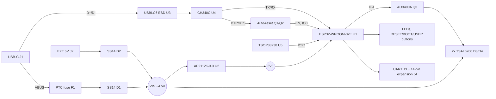
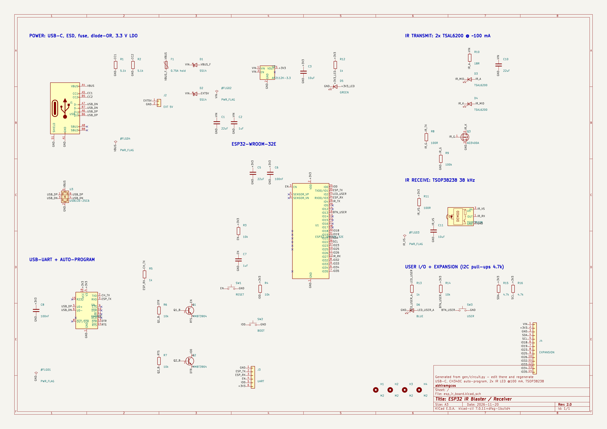

# Build log

One entry per build step, newest at the bottom. Each step is its own git commit, so you can check out any stage.

## Step 1: Archive v1 and review it

* The v1 fab outputs are kept in `v1/fab/` for reference.
* The review is in [v1-review.md](v1-review.md). The copper connectivity is clean, but there are ten design and fab issues.
* The Gerber analysis scripts are in `tools/`.

## Step 2: v2 schematic

The whole circuit is described in one Python file, `gen/circuit.py`. Running `gen/sch.py` turns it into
`hardware/esp_ir_board.kicad_sch`, which you can open in KiCad 7 or newer.

**Checks.** KiCad 7's command line has no ERC command, so `gen/erc.py` compares the exported netlist with
`circuit.py` instead.

* Result: 162 pin assignments checked, 41 nets, 0 problems (no mismatches, no single-pin nets).
* Unused pins carry no-connect flags. Passive-driven power nets have PWR_FLAGs.

**Key design decisions**

| Block | Choice | Reason |
|---|---|---|
| 3.3 V | AP2112K-3.3, 600 mA, ~250 mV dropout | Stays in regulation from a 4.3 V VIN (v1's LD1117 did not) |
| Programming | CH340C (no crystal) at 3.3 V + 2× MMBT3904 auto-reset | One-click flashing over USB-C |
| UART override | 1 k between CH340 TXD and ESP RX | An external adapter on J3 still works |
| IR TX | 2× TSAL6200 in series, 18 Ω from VIN, AO3400A low-side | ≈100 mA at 38 kHz for room-wide range |
| IR RX | TSOP38238 + 100 Ω/10 µF supply filter | Vishay-recommended supply filter |
| User I/O | Blue LED on IO2, USER button on IO13, I²C pull-ups 4.7 k | Ready for firmware and sensors |
| Protection | USBLC6-2SC6 ESD, 0.75 A PTC, Schottky diode-OR | Plugging in USB and external 5 V together is safe |

**GPIO map**

| Function | GPIO | | Function | GPIO |
|---|---|---|---|---|
| IR TX | IO4 | | I²C SDA / SCL | IO21 / IO22 |
| IR RX | IO27 | | Expansion | IO18, 19, 23, 25, 26, 32, 33, 34*, 35* |
| User LED | IO2 | | UART0 | IO1 (TX), IO3 (RX) |
| User button | IO13 | | Boot / reset | IO0 / EN |

\* IO34 and IO35 are input-only.
