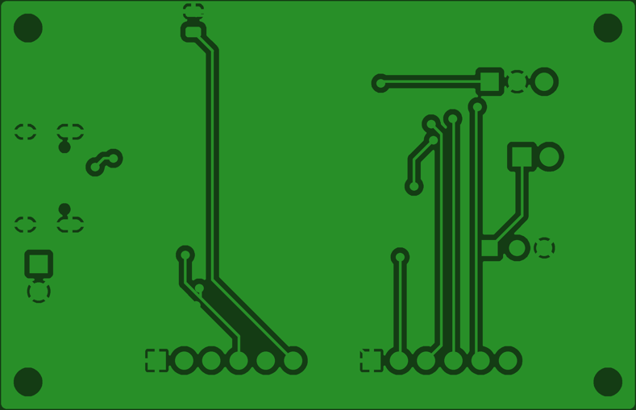

# v1 board review (fab package from 2026-11-18)

The v1 fab package (`v1/fab/`) holds Gerbers, drill files, the BOM and the CPL from KiCad 10.
There were no `.kicad_sch` or `.kicad_pcb` sources, so KiCad's ERC/DRC could not be run. Instead the netlist was
rebuilt from the net/pad attributes KiCad writes into the Gerbers, and the copper was checked against it.

| Top copper | Bottom copper |
|---|---|
|  |  |

## Connectivity check

`tools/gerber_connectivity.py` renders both copper layers, joins them through every plated hole and checks
each net's pads.

* **Result: 0 opens, 0 shorts.** All 21 nets are fully connected and no two nets touch.

## Issues found (all fixed in v2)

| # | Issue | Why it matters | v2 fix |
|---|---|---|---|
| 1 | LD1117 LDO fed through an SS14 diode | 5 V − 0.45 V leaves ~4.3–4.5 V; the LD1117 needs ~1.1–1.2 V headroom, so Wi-Fi bursts can brown out the ESP32 | AP2112K-3.3 (≈0.25 V dropout) |
| 2 | Only 100 nF on the regulator input | Poor transient response on cable inductance | 22 µF + 1 µF on VIN |
| 3 | IR LED driven from 3.3 V via 100 Ω | ≈20 mA, so short range | 2× TSAL6200 in series from VIN at ≈100 mA through an AO3400A MOSFET |
| 4 | J3 (IR receiver) on board but missing from BOM/CPL | The part would never be ordered or placed | TSOP38238 soldered on board and listed in the BOM |
| 5 | Mounting holes H1–H4 listed in the BOM | Assembler queries | Excluded from the BOM |
| 6 | C3 is the only bottom-side part | Double-sided assembly cost | All parts on top |
| 7 | 0.2 mm thermal vias under the ESP32 | JLCPCB lists 0.3 mm as the 2-layer via minimum | Enlarged to 0.3 mm |
| 8 | No LCSC/MPN numbers, rev "rev?", finish "None" | Can't order assembly | MPN + LCSC columns, rev set |
| 9 | No USB data, so programming needs an adapter | Inconvenient | CH340C + auto-reset transistors |
| 10 | No I²C pull-ups, no ESD/fuse, 0.25 mm power traces | Robustness | 4.7 k pull-ups, USBLC6 ESD, PTC fuse, 0.5 mm power traces |

## Verified correct in v1

* **Q1 (P2N2222AG) pinout:** pad 1 is the collector and pad 3 the emitter, matching onsemi TO-92 style 17.
* **D1/D2 orientation:** the diode-OR is correct.
* **USB-C CC lines:** 5.1 k on each.
* **ESP32 reset and boot:** 10 k + 1 µF on EN, 10 k pull-up on IO0.
* **ESP32 pins:** UART on GPIO1/3, and the strapping pins are free.
* **ESP32 antenna:** it overhangs the board edge by ≈6 mm, which is good for RF.
